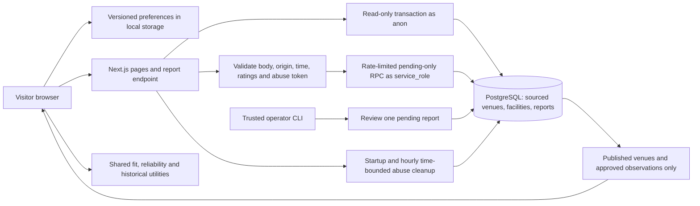

# QuietSpace architecture

The app can also use Supabase REST with anonymous-role reads and a protected server RPC. Its explicit curated mode reads the five source-reviewed JSON records and is read-only. A connection failure never silently becomes curated success.

Anonymous public reads are governed by RLS, source freshness, real/public venue flags and approved-report status. PostgreSQL application transactions drop into the selected fixed role; query values are parameterized. Server credentials cannot be imported into client code. The operator connection remains separate and is not in the deployed application container.

The browser receives only public, validated records and applies its private preferences using shared pure utilities. No preference profile, diagnosis or device geolocation is sent to the server. Report payloads contain only a venue, visit time and nullable 1–5 intensities. Pending receipts do not imply publication.

See [product semantics](product-contract.md), [security/performance](engineering/security-performance.md) and [release procedure](release-checklist.md).
