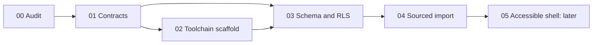

# Phase 00 — repository baseline

Audit date: 2026-10-20 (America/New_York). Starting commit: `4484ced init`.

## Observed state before implementation

- The working tree contained `prompt/QuietSpace_Copyable_Meta_Prompt_and_Codex_Stages.md` (untracked) and `.git/`.
- `git ls-files` listed only `text.txt`, already deleted in the user's working tree. That deletion is preserved.
- No README, application, package manifest, lockfile, routes, dependencies, tests, SQL, deployment configuration, starter ZIP, or credentials were supplied.
- No applicable repository/ancestor AGENTS.md was found. The original prompt is preserved verbatim.
- Node and npm commands failed with command-not-found. `Get-Command docker,psql,supabase` found none. Python 3.14.6 and Git are available.
- HTTPS downloads from the shell failed (PowerShell connection error; Python connection refused). Browsing official sources through the web tool works. No runtime was installed. The user explicitly asked to continue without Node and PostgreSQL.

## Commands and evidence

| Command | Actual initial result |
| --- | --- |
| `Get-ChildItem -Force` and `rg --files --hidden` with generated/private folders excluded | Prompt only; no application files |
| `git status --short` | ` D text.txt`, `?? prompt/` |
| `git log -1 --oneline` | `4484ced init` |
| `git ls-files` | `text.txt` |
| `node --version`, `npm --version` | Command not found |
| `python --version` | Python 3.14.6 |
| `Get-Command docker,psql,supabase,python -ErrorAction SilentlyContinue` | Python only |
| `git diff --check` | Exit 0; no whitespace errors |

There were no existing scripts or application flows to test. No baseline build, accessibility, deployment, or database success is asserted.

## Contract inventory at baseline

UI/API/database contracts: **unimplemented**. The supplied prompt is the requirements source, not evidence that any feature exists. No unsupported real-time claim was found in existing application copy because no application existed.

## Execution graph and bounded deliverables

User authorization covers the first five stages, interpreted as **00–04** because numbering begins at 00. This supersedes the prompt's stop-between-each-stage procedure for this batch. Each stage still gets its own evidence/sign-off, without claiming human review.

| Stage | Priority | One verifiable deliverable |
| --- | --- | --- |
| 00 | P0 | This inventory and risk map |
| 01 | P0 | Product contract, architecture decision, typed interfaces |
| 02 | P0 | Next.js scaffold, explicit setup fallback, scripts and CI |
| 03 | P0 | Versioned migration, deterministic fixtures, adversarial SQL test suite |
| 04 | P0 | Five sourced venues, validated deterministic offline SQL importer |
| 05–06 | P0, later | Accessible shell, then local preferences |
| 07–09 | P0, later | Thresholded scoring, discovery, then evidence details |
| 10–12 | P0, later | Report/moderation path, integrated workflow, reliability |
| 13–15 | P0, later | Accessibility verification, hardening, deployment |
| 16–17 | P1, after P0 | Historical quiet bins, optional map |
| 18 | P0, later | Authentic demo and current official contest-rule verification |

## Risk register

| Severity | Risk | Mitigation / release gate |
| --- | --- | --- |
| Critical | RLS/privilege errors expose pending reports | Revoke default grants, deny client writes, approved-only policies; execute SQL tests on disposable PostgreSQL before release |
| Critical | Missing database tooling masks policy failures | Keep runtime database verification explicitly unexecuted; static checks are not proof of RLS |
| High | No Node, npm or lockfile | Prepare scripts; no fabricated lockfile or build results; first provisioned install must generate/review lockfile |
| High | Invented venue observations/access features | Primary-source fact log; no sensory reports in venue imports; unknown remains null |
| High | Anonymous report abuse | No public write endpoint in these phases; future server validation, distributed rate control and moderation required |
| High | Service credentials in browser | No client database or privileged-key use; env example separates boundaries |
| High | Accessibility assumed from source wording | Retain exact scope of evidence; no inferred step-free access or accessible toilets |
| Medium | Stale sources, hours, coordinates | Omit hours/coordinates without specific evidence; expire publication after 90 days; review source alerts |
| Medium | No core UI yet | Status pages say what is available; phases 05 onward remain unimplemented |
| Medium | Contest unknown | No contest name/URL provided; verify at phase 18, never invent deadlines |

## Phase review

Baseline confirmed against actual tree and Git; no dependencies installed or lockfiles changed for reconnaissance. Future stage additions are documented separately. Review status: prepared for human review, not human-approved.
